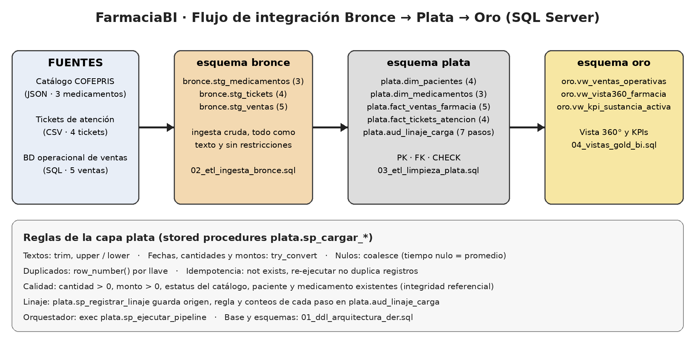
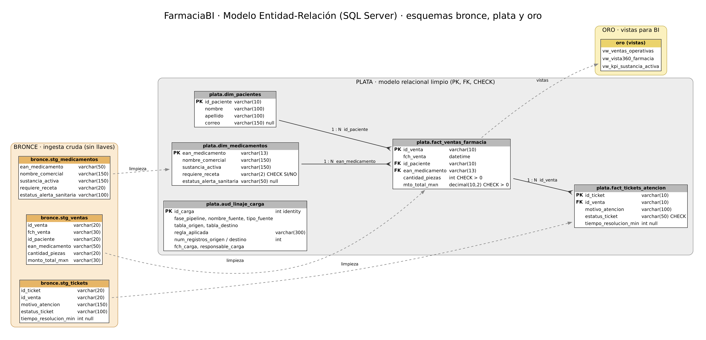

# FarmaciaBI · Operaciones Farmacéuticas y Servicio (Vista 360°)
### Integración de Datos en SQL Server

**Materia:** Integración de Datos | Universidad Iberoamericana León
**Equipo:** 3 | **Tablero Trello:** [Equipo 3 · Proyecto Integrador · Farmacia](https://trello.com/b/3bMUF3YB/equipo-3-proyecto-integrador-farmacia)

## 1. Descripción del Proyecto
FarmaciaBI simula la operación de una farmacia: ventas de medicamentos, el catálogo regulatorio de COFEPRIS y los tickets de atención al cliente. Se integran tres fuentes originales: la base operacional de ventas (SQL), el catálogo de medicamentos (JSON) y los tickets de atención (CSV). El objetivo analítico es una **Vista 360°** que responda preguntas de negocio: cumplimiento normativo (receta vs. venta libre), ventas de productos bajo alerta sanitaria, quejas por principio activo y eficiencia en soporte. Todo se implementa en **Microsoft SQL Server** con una arquitectura de capas Bronce → Plata → Oro.

## 2. Arquitectura de Integración (SQL Server)

* **Esquema `bronce` (Ingesta):** `bronce.stg_medicamentos`, `bronce.stg_tickets` y `bronce.stg_ventas` reciben las fuentes crudas, sin restricciones y con las ventas como texto (fecha, cantidad y monto), para diagnosticarlas antes de limpiarlas. La ingesta se puede repetir: usa `truncate` y vuelve a insertar.
* **Esquema `plata` (Transformación y QA):** los procedimientos `plata.sp_cargar_*` leen bronce sin modificarlo, estandarizan textos (`trim`, `upper`, `lower`), convierten fechas y montos con `try_convert`, imputan nulos con `coalesce`, deduplican con `row_number()` y validan integridad referencial y restricciones `CHECK`. Son idempotentes (`not exists`): `exec plata.sp_ejecutar_pipeline` se puede correr varias veces sin duplicar registros. La bitácora `plata.aud_linaje_carga` guarda el linaje de cada paso.
* **Esquema `oro` (Consumo y BI):** `oro.vw_vista360_farmacia` (Vista 360°), `oro.vw_ventas_operativas` y `oro.vw_kpi_sustancia_activa`, más `oro.sp_historial_paciente`, para responder las preguntas de negocio.

Estándar de nombres (Clase 17): minúsculas y `snake_case`; prefijos `stg_`, `dim_`, `fact_`, `aud_`, `vw_`, `sp_`; abreviaturas `id_`, `fch_` y `mto_`.

## 3. Modelo Entidad-Relación (DER)

8 tablas (3 en bronce y 5 en plata) y 3 llaves foráneas, todas en plata: `fact_ventas_farmacia` → `dim_pacientes`, `fact_ventas_farmacia` → `dim_medicamentos` y `fact_tickets_atencion` → `fact_ventas_farmacia`. Detalle de columnas y tipos en [`DICCIONARIO_DATOS.md`](DICCIONARIO_DATOS.md).

## 4. Estructura del Repositorio (`/src`)
* `01_ddl_arquitectura_der.sql`: creación de la base de datos, los esquemas `bronce`, `plata` y `oro`, las tablas (PK, FK, `CHECK`) y las descripciones de metadatos.
* `02_etl_ingesta_bronce.sql`: scripts de carga inicial (`INSERT`) a bronce y diagnóstico de los datos crudos (nulos, rangos, duplicados y huérfanos).
* `03_etl_limpieza_plata.sql`: procedimientos almacenados de limpieza y reglas de calidad, corrida del pipeline, prueba de idempotencia y validaciones bronce vs. plata.
* `04_vistas_gold_bi.sql`: vistas finales (Vista 360° y KPIs), procedimiento de historial, preguntas de negocio, `sp_ObtenerDiccionarioDatos` y validación de la documentación.

Se ejecutan en orden **01 → 02 → 03 → 04** en SQL Server Management Studio, cada uno completo con F5. El script `01` borra y vuelve a crear la base `FarmaciaBI`; cierra antes cualquier otra pestaña conectada a ella.

Documentación de la Entrega 2, que usaba el modelo anterior sin esquemas (evidencias por integrante y PDF): [`docs/entrega2`](docs/entrega2).

## 5. Integrantes y Roles (4 Roles Oficiales)
* **Data Architect / SQL Specialist:** Vale
* **Data Engineer / Pipeline Lead:** Daniel
* **Data Quality & QA Specialist:** Bruno
* **Líder de Proyecto:** Mariano Muñoz Canchola
* **BI & Analytics Specialist:** Max (Maximiliano)

*(Equipo de 5: el rol 4 se divide en Líder de Proyecto y BI Specialist.)*
